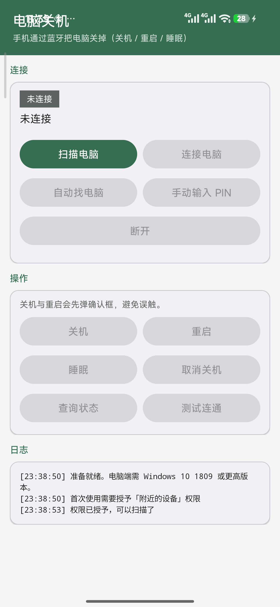

# Phone Shutdown

**Turn your PC off from your phone.** An Android app + a Windows BLE GATT server, no Wi-Fi, no remote desktop, no cloud account.

[](https://github.com/jwutbt7137-lgtm/phone-shutdown-control/actions/workflows/ci.yml)
[](https://github.com/jwutbt7137-lgtm/phone-shutdown-control/releases)
[](LICENSE)

[中文说明](README.md) · [Releases](https://github.com/jwutbt7137-lgtm/phone-shutdown-control/releases)



## What it does

Shut down, restart, sleep or cancel a pending shutdown on a Windows PC over Bluetooth Low Energy.
Only the "turn off" direction exists — once the PC is powered down, its Bluetooth radio is gone too,
so waking it up over BLE is physically impossible.

| Command | What the PC does |
| --- | --- |
| Shutdown | `shutdown /s /t 10` — 10 s countdown, cancellable |
| Restart | `shutdown /r /t 10` |
| Sleep | sleep |
| Cancel | `shutdown /a` |
| Query | report pending state |
| Ping | link check |

## Why BLE

| Option | Problem |
| --- | --- |
| RDP / SSH | needs a network, an account, heavy client |
| Wake-on-LAN | only boots the machine, never shuts it down |
| Smart plug | cuts power, risks data loss |
| **BLE GATT** | **no network, no account, native on both ends, ~10 m range** |

The PC advertises a GATT service via WinRT `GattServiceProvider`; the phone connects as a GATT client.

## Architecture

```
┌──────────────────┐          BLE (GATT)           ┌────────────────────┐
│  Android phone    │  ──────────────────────────▶  │  Windows PC        │
│  "Phone Shutdown" │   AUTH <pin>                  │  pc_server.py      │
│                   │   SHUTDOWN / RESTART / ...    │  → shutdown /s     │
└──────────────────┘                               └────────────────────┘
```

Protocol details (UUIDs, framing, advertisement marker): [docs/协议与架构.md](docs/协议与架构.md) (Chinese).

## Quick start

### 1. PC side

Windows 10 1809+ / Windows 11, BLE-capable adapter, Python 3.9+.

```powershell
cd pc-server
python -m pip install -r requirements.txt
python pc_server.py
```

The console prints a 6-digit PIN. Try it without shutting anything down:

```powershell
python pc_server.py --dry-run     # print commands instead of executing
python pc_server.py --self-test   # verify WinRT BLE APIs
```

### 2. Phone side

Install the APK from [Releases](https://github.com/jwutbt7137-lgtm/phone-shutdown-control/releases),
or build it yourself:

```bash
cd android
./gradlew assembleDebug      # output: app/build/outputs/apk/debug/app-debug.apk
```

Grant the "Nearby devices" permission on first launch (Android 12+ uses `BLUETOOTH_SCAN` /
`BLUETOOTH_CONNECT` with `neverForLocation`; older versions fall back to location permission).

### 3. Pair and use

1. Tap **Scan** → tap the device marked **★**
2. Enter the 6-digit PIN shown on the PC
3. Buttons unlock once authenticated

## Security model

- **PIN auth**: random 6 digits per run (or fixed in `config.json`); unauthenticated clients only get `ERR NEED_AUTH`
- **Single controller**: one authenticated phone at a time, new auth kicks the old one
- **Brute-force lockout**: 5 wrong PINs disconnect the session
- **Undo window**: 10 s countdown before shutdown/restart
- **Audit log**: every command appended to `pc_server.log`

Threat model and private vulnerability reporting: [SECURITY.md](SECURITY.md).

## Project layout

```
android/      Kotlin app (scan, connect, auth, outbound queue)
pc-server/    Python WinRT BLE GATT server, tests, BLE scanner helper
docs/         usage, protocol/architecture, troubleshooting, self-test log
build-apk.ps1 offline toolchain build script (optional)
```

## Development

```powershell
cd pc-server
python -m pip install -r requirements.txt
python test_protocol.py       # no Bluetooth hardware needed, never shuts down
```

End-to-end self test (needs a real adapter): start `python pc_server.py --dry-run`
in one window, then `python test_e2e.py` in another.

## Limitations

- Cannot power the PC on (Bluetooth dies with the PC)
- Cannot wake it from sleep over BLE
- Closing the server window stops the service
- Windows does not let third-party apps set the BLE advertisement name; the app identifies
  the PC via a custom `PSD1` data section instead

## Contributing

Issues and PRs welcome — see [CONTRIBUTING.md](CONTRIBUTING.md).
Security reports: [SECURITY.md](SECURITY.md).

## License

[MIT](LICENSE)
